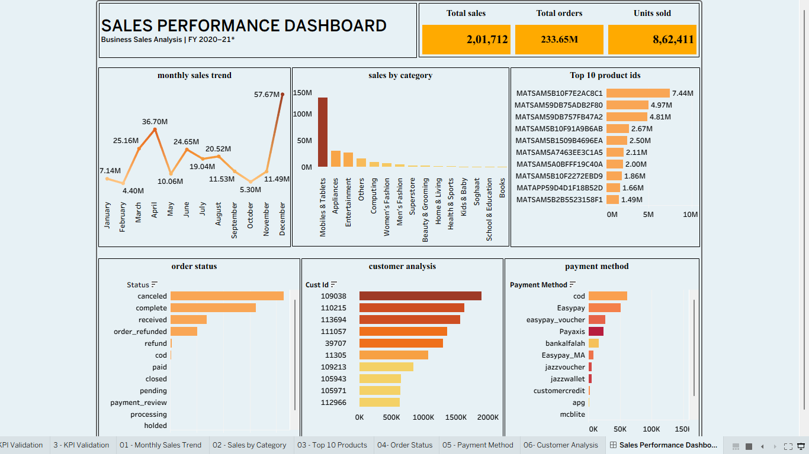

# Sales Performance Dashboard — Tableau

An interactive Tableau dashboard for exploring sales performance, monthly sales trends, product categories, top product IDs, order status, customer analysis, and payment methods for FY 2020–21.

## Dashboard Preview

## Project Overview

This project uses Tableau to present sales-related metrics and business information in a single dashboard. It combines KPI cards with visualizations that support exploration of sales trends and different dimensions of the dataset.

## Dashboard Components

### 1. KPI Cards
- Total Sales
- Total Orders
- Units Sold

### 2. Monthly Sales Trend
Visualizes the monthly sales pattern from January to December.

### 3. Sales by Category
Compares sales across the product categories available in the dataset.

### 4. Top 10 Product IDs
Displays the ten product IDs ranked by the sales measure used in the workbook.

### 5. Order Status
Shows the distribution of the available order-status values.

### 6. Customer Analysis
Compares customer-level values displayed in the dashboard.

### 7. Payment Method
Shows the distribution of the payment methods available in the dataset.

## Tools and Technologies
- Tableau
- Microsoft Excel
- Data Visualization
- Business Analytics

## Project Objective

To develop an interactive dashboard that presents sales metrics and helps users explore monthly sales patterns, category performance, product rankings, order status, customer-level values, and payment methods.

## Skills Demonstrated
- Data exploration and visualization
- KPI presentation
- Bar and line chart creation
- Sorting and ranking
- Dashboard layout and composition
- Business-focused data presentation

## Project Files
- `Sales_Performance_Dashboard.twbx` — packaged Tableau workbook
- `dashboard-preview.png` — dashboard screenshot
- `README.md` — project overview

## Project Links
- **Tableau Public:** [Add your published dashboard URL here](https://public.tableau.com/app/profile/ambi.r/viz/SalesPerformanceDashboard_17926803708690/SalesPerformanceDashboard2).
- **GitHub Repository:** [Add your repository URL here](https://github.com/thefavmaverick-coder/tableau-sales-performance-dashboard.git).

## Summary

This project demonstrates the use of Tableau to combine sales trends, product and category comparisons, and order-related breakdowns in a single dashboard for exploratory business analysis.
